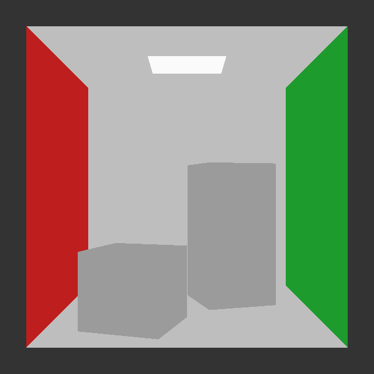
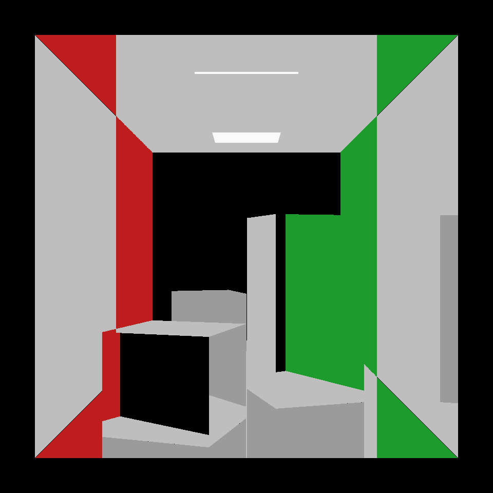

# Arpeggi

DX12/DXR 기반 Path Tracer 졸업프로젝트
직접광부터 MIS, 다중 Bounce까지 구현하고 결과를 비교

## Step별 계획

| Step | 내용 | 상태 |
|---|---|---|
| 0 | DXR 기초, Normal/Hit 정보 반환, Secondary Ray | 완료 |
| 1 | Diffuse BSDF Sampling 직접광, 누적, Mitsuba 비교 | 진행 중 |
| 2 | Light Sampling, Shadow Ray, 직접광 MIS | 예정 |
| 3 | 다중 Bounce Path Tracing, NEE, MIS 통합 | 예정 |

## 진행 화면

| Step0 이전: Cornell Box (Primary Ray) | Step0: Secondary Ray |
|:---:|:---:|
|  |  |

## 실행

[Arpeggi.sln](Arpeggi.sln) → **Step1을 시작 프로젝트로 설정 → Release / x64 → F5**. Visual Studio 2022와 DXR 지원 GPU를 사용

## 원본 및 참고 자료

- Basecode : [acmarrs/IntroToDXR](https://github.com/acmarrs/IntroToDXR)
- [shinyoung-yi/lecture-rendering-mitsuba](https://github.com/shinyoung-yi/lecture-rendering-mitsuba)
